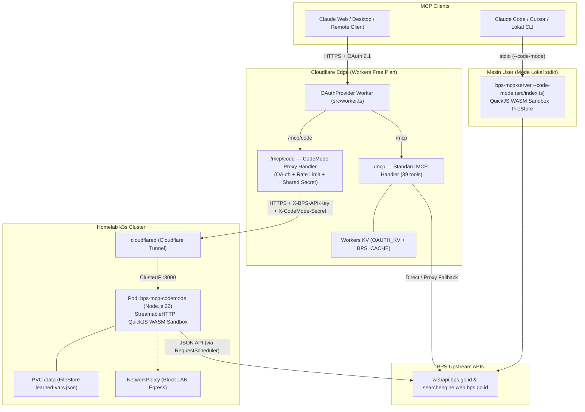

# Rencana Implementasi Code Mode — Pola A (Hybrid Worker Free + k3s Homelab) & Mode Lokal

> **Basis codebase:** `bps-mcp-server` `v0.19.0` (`main` @ `440db83`)  
> **Target arsitektur:** Pola A (Hybrid Cloudflare Worker Free + k3s Homelab via Cloudflare Tunnel) + Mode Lokal (`stdio`) + Cakupan penuh seluruh **39 tools** (termasuk custom Smart & Analysis tools) sebagai API JSON terstruktur.

---

## 1. Tujuan & Ringkasan Arsitektur

Implementasi ini menambahkan **Code Mode** (pola arsitektur Cloudflare di mana LLM menulis skrip JavaScript asinkron terhadap API bertipe di dalam sandbox, alih-alih memanggil puluhan tool satu per satu) dengan tiga prinsip utama:

1. **Pola A (Hybrid Cloudflare Worker Free + k3s Homelab):**
   - **Cloudflare Worker Free** tetap menangani **OAuth 2.1**, rate limiting, dan endpoint `/mcp` standar di edge (tetap 100% online meski homelab sedang maintenance/offline).
   - Endpoint `/mcp/code` di Worker Free memvalidasi OAuth 2.1 lalu mem-proxy request melalui **Cloudflare Tunnel** ke **Pod k3s di homelab** yang menjalankan sandbox **QuickJS WASM**.
   - **Zero `worker_loaders` / Zero WASM di bundle Worker Free** → aman dari batas 10ms CPU time, batas ukuran bundle 3 MB, dan tidak memerlukan paket Workers Paid.
2. **Mode Lokal (`stdio`) Opt-in:**
   - Default `bps-mcp-server` tetap mode standar (39 tools, 100% backward-compatible).
   - Flag `--code-mode` atau env `BPS_CODE_MODE=true` mengaktifkan Code Mode di lokal dengan sandbox QuickJS WASM yang sama (di-load secara *lazy* agar tidak memengaruhi startup/RAM mode standar).
3. **100% Cakupan 39 Tools (termasuk Custom Tools):**
   - Seluruh 39 tool yang terdaftar di [`src/server.ts`](../src/server.ts) — termasuk `find_data`, `find_variable`, `compare_data` (multi-tahun), `get_trend`, `get_ranking` (`provinsi` & `kabkota`), `search` (multi-tipe fan-out + AllStats fallback), `get_trade_data` (nama komoditas + HS chapter derivation), `allstats_search`, `allstats_deep_search`, dan `list_glossary` — tersedia pada namespace `bps.*` dengan **return JSON terstruktur**.

---

## 2. Diagram Arsitektur End-to-End



### Keunggulan Pola A untuk Infrastruktur yang Ada

| Aspek | Solusi di Pola A |
| :--- | :--- |
| **Workers Free Plan (10ms CPU & 3MB bundle)** | Worker Free tidak menjalankan QuickJS WASM maupun `worker_loaders`; hanya validasi OAuth + rate limit + streaming proxy ringan. |
| **Ketersediaan / Uptime** | Jika homelab mati/maintenance, `/mcp` standar tetap 100% online di edge; `/mcp/code` mengembalikan `503` informatif yang menyarankan fallback ke `/mcp`. |
| **OAuth 2.1 Compatibility** | `@cloudflare/workers-oauth-provider` tetap melayani Claude.ai, Claude Desktop, dan client remote MCP tanpa perlu menulis ulang OAuth server di Node.js. |
| **BYOK (Bring Your Own Key)** | API key BPS user tetap diteruskan per-request dari `ctx.props.bpsApiKey`. Pod k3s tidak menyimpan API key user ke disk. |
| **Anti-429 BPS API** | Seluruh pemanggilan `Promise.all(...)` dari dalam skrip LLM otomatis melewati `BpsClient` + [`src/client/request-scheduler.ts`](../src/client/request-scheduler.ts) (`defaultScheduler`) sehingga tetap terkendali dari rate-limit/WAF BPS. |
| **Keamanan Homelab** | 3 lapis proteksi: (1) Shared secret `X-CodeMode-Secret` (+ opsional Cloudflare Access Service Token), (2) Sandbox QuickJS WASM tanpa akses jaringan/FS/env, (3) Hardened Pod + `NetworkPolicy` anti-SSRF ke LAN rumah. |

---

## 3. Memanfaatkan Pondasi Terstruktur `v0.19.0` (Single Source of Truth)

Sejak `v0.17.0`–`v0.19.0`, sebagian besar logika kompleks **sudah dipisahkan** ke layer `src/services/` dengan tipe kembalian terstruktur:
- [`src/services/data-formatter.ts`](../src/services/data-formatter.ts): sudah memiliki `toStructuredRows()` dan `buildStructuredPayload()` untuk `get_dynamic_data(format="json")`.
- [`src/services/kabkota-ranking.ts`](../src/services/kabkota-ranking.ts): sudah memisahkan `rankKabkota()` (return `KabkotaRankingResult`) dari `formatKabkotaRanking()`.
- [`src/services/region-series.ts`](../src/services/region-series.ts): sudah memiliki `buildRegionSeries()` (`RegionSeries`) dan `buildNationalBreakdown()` (`NationalBreakdown`).
- [`src/services/period-resolver.ts`](../src/services/period-resolver.ts): sudah memiliki `parseYearSpec()` & `resolvePeriodsForSpec()` untuk rentang tahun langsung (`"2021-2025"`).
- [`src/services/search-query.ts`](../src/services/search-query.ts): sudah memiliki `searchQueryFallbacks()` dan `inferContentTypeFromUrl()`.
- [`src/client/request-scheduler.ts`](../src/client/request-scheduler.ts): sudah mengatur concurrency terhadap BPS WebAPI.

Kita tinggal mengekstrak sisa logika orkestrasi di beberapa file `src/tools/` (yang saat ini masih menyatu dengan formatting Markdown) ke core service agar **Mode Standar** dan **Code Mode** memakai satu *source of truth* yang sama:

```text
Core Service (return JSON terstruktur)
   ├──► Standard MCP Tools (src/tools/*.tools.ts) ──► Format Markdown + Attribution (perilaku 100% identik)
   └──► Code Mode API (src/codemode/bps-api.ts)   ──► Return JSON langsung ke QuickJS sandbox
```

### Pemetaan Lengkap 39 Tools ke Namespace `bps.*`

#### A. Custom Smart & Analysis Tools (5 tools)
Ekstrak orkestrasi dari [`src/tools/smart.tools.ts`](../src/tools/smart.tools.ts) → `src/services/smart-service.ts` dan [`src/tools/analysis.tools.ts`](../src/tools/analysis.tools.ts) → `src/services/analysis-service.ts` (memanfaatkan `region-series.ts`, `kabkota-ranking.ts`, `period-resolver.ts`, `variable-search.ts` yang sudah ada):

| # | Standard MCP Tool | Code Mode Method | Return JSON Terstruktur |
| :-: | :--- | :--- | :--- |
| 1 | `find_data` | `bps.findData({ query, region?, year?, bypassRedirect? })` | `{ source, domain, domainName, varId?, varTitle, unit?, periods?, rows, detectedIntent?, hints? }` *(di Code Mode `bypassRedirect` default `true` agar skrip tidak berhenti di pesan redirect teks)* |
| 2 | `find_variable` | `bps.findVariable({ keyword, domain?, subject? })` | `{ domain, count, variables: [{ var_id, title, sub_name, unit?, def? }] }` |
| 3 | `compare_data` | `bps.compareData({ query, regions, year?, years?, start_year?, end_year? })` | `{ varTitle, unit?, multiYear, usedNationalTable, series: RegionSeries[], summary? }` *(mendukung `regions` berupa `string` atau `string[]`, plus alias `wilayah`/`provinces`, single-year maupun multi-year)* |
| 4 | `get_trend` | `bps.getTrend({ query, region?, start_year?, end_year?, years? })` | `{ varTitle, unit?, domain, domainName, seriesLabel?, missingYears, points: [{ year, value, changePct }], totalChangePct?, direction?, headlineFallback? }` |
| 5 | `get_ranking` | `bps.getRanking({ query, level, top_n?, order?, year?, period_mode?, provinces? })` | `{ level: "provinsi" \| "kabkota", indicator, unit?, order, targetYear?, periods?, totalRegions, provincesCovered?, missingProvinces?, rows }` *(memanfaatkan langsung `rankKabkota()` & struktur JSON `get_ranking`)* |

#### B. Domain & Wilayah (2 tools)
| # | Standard MCP Tool | Code Mode Method | Return JSON Terstruktur |
| :-: | :--- | :--- | :--- |
| 6 | `list_domains` | `bps.listDomains({ type?, prov? })` | `{ count, domains: BpsDomain[] }` |
| 7 | `resolve_domain` | `bps.resolveDomain({ query })` | `{ found, domainId?, domainName? }` |

#### C. Dynamic Data & Metadata (9 tools)
| # | Standard MCP Tool | Code Mode Method | Return JSON Terstruktur |
| :-: | :--- | :--- | :--- |
| 8 | `list_subjects` | `bps.listSubjects({ domain?, subcat? })` | `BpsSubject[]` |
| 9 | `list_subject_categories` | `bps.listSubjectCategories({ domain? })` | `BpsSubjectCategory[]` |
| 10 | `list_variables` | `bps.listVariables({ domain?, subject?, year?, page? })` | `{ page, data: BpsVariable[] }` |
| 11 | `list_vertical_variables` | `bps.listVerticalVariables({ domain?, var? })` | `BpsVerticalVariable[]` |
| 12 | `list_derived_variables` | `bps.listDerivedVariables({ domain?, var? })` | `BpsDerivedVariable[]` |
| 13 | `list_periods` | `bps.listPeriods({ domain?, var?, page? })` | `BpsPeriod[]` |
| 14 | `list_derived_periods` | `bps.listDerivedPeriods({ domain?, var? })` | `BpsDerivedPeriod[]` |
| 15 | `list_units` | `bps.listUnits({ domain?, page? })` | `BpsUnit[]` |
| 16 | `get_dynamic_data` | `bps.getDynamicData({ domain?, var, th?, turvar?, vervar?, turth?, raw? })` | Default mengembalikan hasil **`buildStructuredPayload()`** (`{ indicator, domain, unit, periods, missingYears?, rows: StructuredRow[] }`) lengkap dengan resolusi `th` via `resolvePeriodsForSpec()`; opsi `raw: true` tersedia untuk payload mentah BPS. |

#### D. Search & AllStats (3 tools)
Ekstrak orkestrasi multi-tipe fan-out + AllStats fallback dari [`src/tools/search.tools.ts`](../src/tools/search.tools.ts) dan root-word retry dari [`src/tools/allstats.tools.ts`](../src/tools/allstats.tools.ts) ke `src/services/search-service.ts`:

| # | Standard MCP Tool | Code Mode Method | Return JSON Terstruktur |
| :-: | :--- | :--- | :--- |
| 17 | `search` | `bps.search({ keyword, domain?, type?, page? })` | `{ source, type, groups?: { statictable, publication, pressrelease, strategicindicator }, results?, page? }` |
| 18 | `allstats_search` | `bps.allstatsSearch({ query, content?, domain?, page?, title_only?, year_from?, year_to?, sort? })` | `AllStatsSearchResponse` (termasuk retry root-word dari `searchQueryFallbacks()`) |
| 19 | `allstats_deep_search` | `bps.allstatsDeepSearch({ query, publication_id, domain?, page? })` | `AllStatsDeepSearchResponse` |

#### E. Static Tables, Publications, Press Releases, Reference, Trade & Glossary (9 tools)
Ekstrak logika komoditas/HS chapter & agregasi dari [`src/tools/trade.tools.ts`](../src/tools/trade.tools.ts) dan fallback definisi variabel dari [`src/tools/glossary.tools.ts`](../src/tools/glossary.tools.ts) ke `src/services/trade-service.ts` dan `src/services/glossary-service.ts`:

| # | Standard MCP Tool | Code Mode Method | Return JSON Terstruktur |
| :-: | :--- | :--- | :--- |
| 20 | `list_static_tables` | `bps.listStaticTables({ domain?, keyword?, page? })` | `{ page, data: BpsStaticTable[] }` |
| 21 | `get_static_table` | `bps.getStaticTable({ domain, id })` | `{ table_id, title, subj, updt_date, markdownTable, headers?, rows? }` |
| 22 | `list_publications` | `bps.listPublications({ domain?, keyword?, year?, month?, page? })` | `{ page, data: BpsPublication[] }` |
| 23 | `get_publication` | `bps.getPublication({ domain, id })` | `BpsPublication` (HTML dibersihkan) |
| 24 | `list_press_releases` | `bps.listPressReleases({ domain?, keyword?, year?, month?, page? })` | `{ page, data: BpsPressRelease[] }` |
| 25 | `get_press_release` | `bps.getPressRelease({ domain, id })` | `BpsPressRelease` (HTML dibersihkan) |
| 26 | `list_strategic_indicators` | `bps.listStrategicIndicators({ domain?, page? })` | `{ page, data: BpsStrategicIndicator[] }` |
| 27 | `get_trade_data` | `bps.getTradeData({ source?, hs_code?, commodity?, hs_type?, year?, period? })` | `{ source, hsCode, requestedCode, commodityLabel?, note?, year, period, totalValue, totalWeight, rowCount, byCountry: [{ country, value, weight, rows }] }` |
| 28 | `list_glossary` | `bps.listGlossary({ domain?, keyword?, page? })` | `{ source: "glossary" \| "variables" \| "documents", items: [...] }` |

#### F. Infographics, News, Census, CSA & Utility (11 tools)
| # | Standard MCP Tool | Code Mode Method | Return JSON Terstruktur |
| :-: | :--- | :--- | :--- |
| 29 | `list_infographics` | `bps.listInfographics({ domain?, keyword?, page? })` | `{ page, data: BpsInfographic[] }` |
| 30 | `get_infographic` | `bps.getInfographic({ domain, id })` | `BpsInfographicDetail` |
| 31 | `list_news` | `bps.listNews({ domain?, keyword?, newscat?, year?, month?, page? })` | `{ page, data: BpsNews[] }` |
| 32 | `get_news` | `bps.getNews({ domain, id })` | `BpsNewsDetail` |
| 33 | `list_census_events` | `bps.listCensusEvents()` | `BpsCensusEvent[]` |
| 34 | `list_census_topics` | `bps.listCensusTopics({ kegiatan })` | `BpsCensusTopic[]` |
| 35 | `list_csa_categories` | `bps.listCsaCategories({ domain? })` | `BpsCsaSubjectCategory[]` |
| 36 | `list_csa_subjects` | `bps.listCsaSubjects({ domain?, subcat? })` | `BpsCsaSubject[]` |
| 37 | `list_csa_tables` | `bps.listCsaTables({ domain?, subject?, keyword?, page? })` | `{ page, data: BpsCsaTable[] }` |
| 38 | `get_csa_table` | `bps.getCsaTable({ domain, id })` | `{ ...detail, markdownTable }` |
| 39 | `cache_clear` | `bps.clearCache()` | `{ cleared: boolean, message: string }` |

> **Helper in-sandbox tambahan:** `bps.help(methodName?)` tersedia di dalam QuickJS untuk melihat parameter lengkap & contoh pemakaian method tertentu tanpa membebani deskripsi tool utama.

---

## 4. Desain Tool MCP di Code Mode (`execute_bps_code`)

Alih-alih mendaftarkan 39 tool (~12.000–18.000 token per turn), Code Mode MCP server hanya mendaftarkan **1 tool utama**:

- **Nama tool:** `execute_bps_code`
- **Input schema:** `{ code: z.string() }`
- **Server `instructions`:** Mempertahankan aturan routing BPS penting dari `SERVER_INSTRUCTIONS` di [`src/server.ts`](../src/server.ts) yang disesuaikan untuk Code Mode (mis. gunakan `bps.getRanking({ level: "kabkota" })`, jangan sweep 38 provinsi manual; gunakan `bps.compareData` untuk perbandingan multi-tahun; sebutkan tahun data secara akurat).
- **Deskripsi tool:** Memuat:
  1. Aturan penulisan skrip (ES2022+ async JavaScript, gunakan `await bps.*`, manfaatkan `Promise.all()`, kembalikan hanya ringkasan akhir).
  2. Quick reference `var_id` nasional populer (`185`, `192`, `543`, `413`, `2781`, `98`, `2263`).
  3. **Deklarasi TypeScript ringkas (`declare const bps = { ... }`)** untuk seluruh 39 method (~1.800–2.400 token → **hemat ~80–85% token schema**).
- **Resources & Prompts:** [`src/resources/domain.resources.ts`](../src/resources/domain.resources.ts) dan [`src/prompts/analysis.prompts.ts`](../src/prompts/analysis.prompts.ts) tetap didaftarkan.

### Normalisasi Kode (`src/codemode/normalize-code.ts`)
1. Menghapus markdown code fence (```` ```js ```` / ```` ```ts ```` / ```` ``` ````) bila LLM menyertakannya.
2. Pada Node ≥ 22.6, men-strip anotasi TypeScript secara defensif via `module.stripTypeScriptTypes` bila LLM menulis sintaks TypeScript.
3. Mendukung 3 gaya penulisan otomatis:
   - `async () => { ... }` → `(${code})()`
   - `async function() { ... }` → `(${code})()`
   - Top-level statements (`const x = await bps.findData(...); return x;`) → `(async () => {\n${code}\n})()`

### Format Output Tool
```json
{
  "result": { "...": "hasil return skrip" },
  "logs": ["(opsional, hanya muncul jika ada console.log)"],
  "meta": {
    "durationMs": 842,
    "callsUsed": 4,
    "truncated": false
  }
}
```
Diakhiri atribusi BPS resmi dari [`src/services/attribution.ts`](../src/services/attribution.ts).

---

## 5. Desain Sandbox Keamanan (`QuickJSExecutor`)

Abstraksi `CodeExecutor` di `src/codemode/executor.ts` dirancang **kompatibel dengan kontrak `@cloudflare/codemode`** agar dapat di-swap ke `DynamicWorkerExecutor` di masa depan tanpa mengubah API:

```ts
export interface ExecuteOptions {
  timeoutMs?: number;
  memoryLimitBytes?: number;
  maxStackSizeBytes?: number;
  maxCalls?: number;
  maxOutputBytes?: number;
  maxLogBytes?: number;
}

export interface ExecuteResult {
  result?: unknown;
  error?: string;
  logs: string[];
  callsUsed: number;
  durationMs: number;
  truncated?: boolean;
}

export interface CodeExecutor {
  execute(
    code: string,
    fns: Record<string, (args?: Record<string, unknown>) => Promise<unknown>>,
    options?: ExecuteOptions
  ): Promise<ExecuteResult>;
}
```

### Implementasi `src/codemode/quickjs-executor.ts` (`quickjs-emscripten`)
- **Lazy singleton WASM module:** `getQuickJS()` dimuat sekali saja saat eksekusi Code Mode pertama (zero overhead untuk mode `stdio` standar).
- **Fresh isolate per eksekusi:** Setiap `execute()` membuat `runtime` & `vm` baru, selalu di-`dispose()` dalam `finally`.
- **Guardrails Keamanan (configurable via env):**

| Env Variable | Default | Perlindungan |
| :--- | :--- | :--- |
| `CODEMODE_MEMORY_LIMIT_MB` | `32` | `runtime.setMemoryLimit(...)` — mencegah memory bomb / OOM |
| `CODEMODE_STACK_LIMIT_KB` | `512` | `runtime.setMaxStackSize(...)` — mencegah infinite recursion |
| `CODEMODE_TIMEOUT_MS` | `25000` | `shouldInterruptAfterDeadline` (CPU loop) + `Promise.race` (I/O hang) |
| `CODEMODE_MAX_CALLS` | `30` | Batas maksimal pemanggilan `bps.*` per eksekusi (mencegah spam BPS API) |
| `CODEMODE_MAX_OUTPUT_BYTES` | `51200` | Membatasi hasil return max 50 KB + penanda `truncated: true` |
| `CODEMODE_MAX_LOG_BYTES` | `4096` | Membatasi tangkapan `console.log/warn/error` |

- **Zero Ambient Capabilities:** Tidak ada `fetch`, `require`, `process`, `fs`, `setTimeout`, atau env vars di dalam guest VM — hanya global `bps` dan `console`.
- **Safe Async Disposal:** Flag `disposed` mencegah callback host async yang terlambat resolve setelah timeout menyentuh `QuickJSHandle`/`runtime` yang sudah di-dispose.
- **Validasi Zod per Method:** Setiap pemanggilan `bps.<method>(args)` divalidasi dengan Zod sebelum diteruskan ke service/client.

---

## 6. Integrasi 3 Runtime & Infrastruktur

### A. Mode Lokal (`stdio`) — [`src/index.ts`](../src/index.ts)
- Default tetap **Standard MCP (39 tools)**.
- Aktifkan Code Mode dengan `--code-mode` atau env `BPS_CODE_MODE=true` (atau `BPS_MODE=code`).
- Memakai `QuickJSExecutor` + `InMemoryCache` + `FileStore` (`~/.bps-mcp/learned-vars.json`).
- Contoh konfigurasi client lokal:
  ```json
  {
    "mcpServers": {
      "bps-code": {
        "command": "npx",
        "args": ["-y", "bps-mcp-server", "--code-mode"],
        "env": { "BPS_API_KEY": "your_api_key" }
      }
    }
  }
  ```

### B. Cloudflare Worker Free (Proxy Pola A) — [`src/worker.ts`](../src/worker.ts)

> **Catatan teknis penting (`@cloudflare/workers-oauth-provider`):** `matchApiRoute()` menggunakan `url.pathname.startsWith(route)` sesuai urutan properti pada `apiHandlers`. Oleh karena itu **`"/mcp/code"` WAJIB ditulis SEBELUM `"/mcp"`**!

1. **Tambahkan binding/secret di `Env` ([`src/worker.ts`](../src/worker.ts)):**
   - `CODEMODE_BACKEND_URL?: string` (di [`wrangler.toml`](../wrangler.toml), mis. `https://bps-codemode.murphi.my.id`)
   - `CODEMODE_SHARED_SECRET?: string` (via `npx wrangler secret put CODEMODE_SHARED_SECRET`)
   - `CF_ACCESS_CLIENT_ID?: string` & `CF_ACCESS_CLIENT_SECRET?: string` *(opsional, jika Cloudflare Tunnel juga dilindungi Cloudflare Access)*
2. **Routing `apiHandlers` di [`src/worker.ts`](../src/worker.ts):**
   ```ts
   apiHandlers: {
     "/mcp/code": CodeModeProxyHandler,
     "/mcp": McpHandler,
   }
   ```
3. **`src/worker-codemode-proxy.ts`:**
   - Berbagi helper rate limit (`src/worker-rate-limit.ts`) dengan [`src/worker-mcp.ts`](../src/worker-mcp.ts).
   - Mengambil `bpsApiKey` dari `ctx.props.bpsApiKey` (hasil OAuth 2.1).
   - Jika `CODEMODE_BACKEND_URL` belum di-set → return `503` JSON ramah yang mengarahkan client ke `/mcp`.
   - Forward request (`POST`/`GET`/`DELETE`, header `Content-Type`, `Accept`, `Mcp-Session-Id`, body) ke `${env.CODEMODE_BACKEND_URL}/mcp/code` dengan timeout `35_000` ms serta menyuntikkan header:
     - `X-BPS-API-Key: <bpsApiKey>`
     - `X-CodeMode-Secret: <env.CODEMODE_SHARED_SECRET>`
     - `CF-Access-Client-Id` / `CF-Access-Client-Secret` *(bila diset)*
   - Jika homelab down/timeout → return `503 Service Unavailable` dengan pesan jelas bahwa Code Mode sedang tidak tersedia dan `/mcp` standar tetap aktif.
4. **Update `/health` di [`src/worker.ts`](../src/worker.ts):**
   - Laporkan `codeModeEndpoint: "/mcp/code"` dan `codeModeEnabled: Boolean(env.CODEMODE_BACKEND_URL)`.
5. **Isolasi TypeScript Build ([`tsconfig.json`](../tsconfig.json) & [`tsconfig.worker.json`](../tsconfig.worker.json)):**
   - Exclude `src/worker-codemode-proxy.ts` dan `src/worker-rate-limit.ts` dari `tsconfig.json` (build Node/npm).
   - Exclude `src/http-server.ts` dan `src/codemode/quickjs-executor.ts` dari `tsconfig.worker.json` (build Cloudflare Worker) sehingga `quickjs-emscripten` WASM **tidak pernah** masuk bundle Worker Free.

### C. k3s Homelab Backend (`src/http-server.ts`, `Dockerfile`, `k8s/`)
1. **HTTP Server (`src/http-server.ts`):**
   - Menggunakan `node:http` bawaan + `StreamableHTTPServerTransport` stateless (`sessionIdGenerator: undefined`) dari `@modelcontextprotocol/sdk/server/streamableHttp.js`.
   - Endpoints:
     - `POST/GET/DELETE /mcp/code` → Code Mode MCP Server.
     - `GET /healthz` (liveness probe — selalu `200 OK`).
     - `GET /readyz` (readiness probe — memastikan QuickJS WASM siap).
   - **Autentikasi & Perlindungan:**
     - Wajib cocokkan `X-CodeMode-Secret` dengan `process.env.CODEMODE_SHARED_SECRET` menggunakan `crypto.timingSafeEqual` (fail-closed `401` bila secret tidak diset/salah).
     - Wajib header `X-BPS-API-Key` per-request (BYOK).
     - Batas body request `256 KB` + concurrency limiter (`CODEMODE_MAX_CONCURRENT=8`).
   - **Cache & Persistent Store:**
     - Shared `InMemoryCache` (TTL & max entries configurable) untuk menghemat panggilan BPS API.
     - Update [`src/services/file-store.ts`](../src/services/file-store.ts) mendukung `BPS_DATA_DIR` (di k3s: `/data` mounted ke PVC) + sinkronisasi opsional dengan Worker Learning API (`BPS_WORKER_URL`).
     - Graceful shutdown (`SIGTERM`/`SIGINT`) → flush `FileStore` & tutup HTTP server.
2. **Docker & Manifest k3s:**
   - `Dockerfile` multi-stage berbasis `node:22-slim` (multi-arch `linux/amd64` + `linux/arm64`), non-root user `node` (UID 1000).
   - `k8s/deployment.yaml`:
     - `securityContext`: `runAsNonRoot: true`, `readOnlyRootFilesystem: true`, `allowPrivilegeEscalation: false`, `capabilities: { drop: ["ALL"] }`.
     - `volumeMounts`: `/data` (PVC) dan `/tmp` (`emptyDir`, 32Mi).
     - `resources`: `requests: { cpu: "100m", memory: "128Mi" }`, `limits: { cpu: "500m", memory: "384Mi" }`.
     - `livenessProbe` (`/healthz`) & `readinessProbe` (`/readyz`).
   - `k8s/service.yaml`: `ClusterIP` port `3000`.
   - `k8s/pvc.yaml`: `PersistentVolumeClaim` (`local-path` bawaan k3s).
   - `k8s/secret.example.yaml`: template Secret `CODEMODE_SHARED_SECRET`.
   - `k8s/networkpolicy.yaml`: izinkan ingress dari pod `cloudflared`, blokir egress ke CIDR privat (`10.0.0.0/8`, `172.16.0.0/12`, `192.168.0.0/16`, `169.254.0.0/16`) kecuali DNS cluster (port 53).
   - `docs/DEPLOY-K3S-CODEMODE.md`: panduan setup Cloudflare Tunnel ingress (`http://bps-mcp-codemode.<namespace>.svc.cluster.local:3000`), `wrangler secret put`, dan opsional Cloudflare Access Service Token.

---

## 7. Daftar File yang Ditambah / Diubah

| Aksi | Path File | Peran |
| :--- | :--- | :--- |
| **Baru** | `src/services/smart-service.ts` | Core logic JSON `find_variable` & `find_data` |
| **Baru** | `src/services/analysis-service.ts` | Core logic JSON `compare_data`, `get_trend`, `get_ranking` |
| **Baru** | `src/services/search-service.ts` | Core logic JSON `search` (multi-type + AllStats fallback) & `allstats_search` (root retry) |
| **Baru** | `src/services/trade-service.ts` | Core logic JSON `get_trade_data` (komoditas, HS chapter, agregasi) |
| **Baru** | `src/services/glossary-service.ts` | Core logic JSON `list_glossary` (glossary + variable definitions fallback) |
| **Edit** | `src/tools/smart.tools.ts`, `analysis.tools.ts`, `search.tools.ts`, `allstats.tools.ts`, `trade.tools.ts`, `glossary.tools.ts`, `dynamic-data.tools.ts` | Delegasikan pengambilan data ke core service; output Markdown tetap 100% identik |
| **Edit** | `src/services/file-store.ts` | Dukung env `BPS_DATA_DIR` untuk mount PVC di k3s |
| **Baru** | `src/codemode/executor.ts` | Interface `CodeExecutor`, `ExecuteResult`, `ExecuteOptions` |
| **Baru** | `src/codemode/normalize-code.ts` | Normalizer kode LLM (code fence, async wrapper, defensive TS strip) |
| **Baru** | `src/codemode/quickjs-executor.ts` | Sandbox `QuickJSExecutor` (`quickjs-emscripten`) + guardrails |
| **Baru** | `src/codemode/bps-api.ts` | Registry lengkap seluruh 39 method `bps.*` + validasi Zod + `bps.help()` |
| **Baru** | `src/codemode/types-doc.ts` | Deklarasi `declare const bps` & prompt tool `execute_bps_code` |
| **Baru** | `src/codemode/server.ts` | Factory `createCodeModeServer(...)` |
| **Edit** | `src/index.ts`, `src/config/index.ts` | Tambah flag CLI `--code-mode` & env `BPS_CODE_MODE` |
| **Baru** | `src/http-server.ts` | Entrypoint Node.js Streamable HTTP untuk k3s (`/mcp/code`, `/healthz`, `/readyz`) |
| **Baru** | `src/worker-rate-limit.ts` | Helper rate-limit bersama untuk Worker handlers |
| **Baru** | `src/worker-codemode-proxy.ts` | Proxy handler Pola A di Cloudflare Worker Free |
| **Edit** | `src/worker.ts`, `src/worker-mcp.ts`, `wrangler.toml` | Multi-route `apiHandlers` (`/mcp/code` sebelum `/mcp`), `/health` update |
| **Edit** | `package.json`, `tsconfig.json`, `tsconfig.worker.json` | Tambah `quickjs-emscripten`, script `start:http`/`dev:http`, isolasi tsconfig |
| **Baru** | `Dockerfile`, `.dockerignore`, `k8s/*.yaml`, `docs/DEPLOY-K3S-CODEMODE.md` | Packaging container, manifest k3s, panduan Cloudflare Tunnel |
| **Edit** | `.github/workflows/ci.yml` (+ opsional `docker.yml`) | Tambah `npm run typecheck:worker` (+ opsional build image multi-arch ke GHCR) |

---

## 8. Fase Implementasi Bertahap

1. **Fase 1 — Ekstraksi Core Service (Zero Behavior Change):**
   - Ekstrak `smart-service.ts`, `analysis-service.ts`, `search-service.ts`, `trade-service.ts`, `glossary-service.ts`.
   - Refactor tipis tool terkait agar menggunakan core service; pastikan seluruh unit test yang ada (`npm run test:unit`) lulus 100% tanpa regresi.
2. **Fase 2 — Sandbox `QuickJSExecutor` & Normalizer:**
   - Install `quickjs-emscripten`.
   - Bangun `executor.ts`, `normalize-code.ts`, dan `quickjs-executor.ts`.
   - Tambah unit test keamanan sandbox (infinite loop, memory limit, stack limit, max calls, isolasi global, concurrent `Promise.all`, safe timeout disposal).
3. **Fase 3 — Katalog 39 Method `bps.*` & `createCodeModeServer`:**
   - Bangun `bps-api.ts` (seluruh 39 method + `bps.help()`), `types-doc.ts`, dan `codemode/server.ts`.
   - Tambah unit test cakupan 39 method, validasi Zod, dan komposisi multi-tool (`Promise.all`).
4. **Fase 4 — Mode Lokal (`stdio`) & Node HTTP Server (`src/http-server.ts`):**
   - Tambah `--code-mode` / `BPS_CODE_MODE` di `src/index.ts`.
   - Dukung `BPS_DATA_DIR` di `src/services/file-store.ts`.
   - Bangun `src/http-server.ts` + unit test auth secret (`timingSafeEqual`), BYOK header, `/healthz`, `/readyz`, concurrency limit, dan alur Streamable HTTP MCP.
5. **Fase 5 — Cloudflare Worker Free Proxy (Pola A):**
   - Bangun `worker-rate-limit.ts` dan `worker-codemode-proxy.ts`.
   - Update `src/worker.ts` (`apiHandlers` dengan `/mcp/code` sebelum `/mcp`) & isolasi `tsconfig.json` / `tsconfig.worker.json`.
   - Tambah unit test proxy & verifikasi `npm run typecheck:worker` + `npm run deploy:dry`.
6. **Fase 6 — Packaging k3s, Dokumentasi & Verifikasi Akhir:**
   - Buat `Dockerfile`, `.dockerignore`, `k8s/*.yaml`, dan `docs/DEPLOY-K3S-CODEMODE.md`.
   - Jalankan full gate:
     ```bash
     npm run lint && npm run typecheck && npm run typecheck:worker && npm run build && npm run test:unit && npm run deploy:dry
     ```

---

## 9. Strategi Verifikasi & Pengujian

- **Unit Tests Baru (`tests/unit/codemode/`):**
  - `quickjs-executor.test.ts`: normal execution, `Promise.all`, `console.log`, error propagation, infinite loop abort, memory limit, stack limit, max calls limit, output truncation, isolasi global (`typeof process === "undefined"`, `typeof fetch === "undefined"`).
  - `normalize-code.test.ts`: markdown fences, arrow/function expressions, top-level statements, TS type stripping.
  - `bps-api.test.ts`: kelengkapan 39 method + parity output JSON custom tools (`findData`, `compareData`, `getTrend`, `getRanking` provinsi & kabkota, `getTradeData`, `search`, `listGlossary`).
  - `http-server.test.ts`: validasi secret, missing API key, Streamable HTTP `initialize` → `tools/list` (hanya 1 tool) → `tools/call`.
  - `worker-codemode-proxy.test.ts`: forwarding OAuth `bpsApiKey`, header secret injection, `503` saat backend offline/belum diset, route precedence `/mcp/code` vs `/mcp`.
- **Bundle & Build Verification:**
  - `npm run typecheck`, `npm run typecheck:worker`, `npm run build`, dan `npm run deploy:dry` (memastikan WASM tidak terbawa ke Worker Free).
- **Smoke Test Manual:**
  - Lokal: `BPS_API_KEY=... node dist/index.js --code-mode` via `@modelcontextprotocol/inspector`.
  - Container/k3s: `docker build` + uji `POST /mcp/code` lokal sebelum deploy ke cluster k3s.

---

## 10. Keputusan Konfigurasi Sebelum Eksekusi

| # | Keputusan | Default yang Disarankan | Alternatif |
| :-: | :--- | :--- | :--- |
| 1 | **Nama endpoint Worker** | `/mcp/code` | `/codemode` |
| 2 | **Akses langsung ke Pod k3s** | Wajib `X-CodeMode-Secret` (hanya dari Worker) | Izinkan akses langsung pakai `X-BPS-API-Key` saja |
| 3 | **CI Docker image (GHCR)** | Tambah `.github/workflows/docker.yml` multi-arch (`amd64` + `arm64`) | Build `Dockerfile` lokal/manual dulu |
